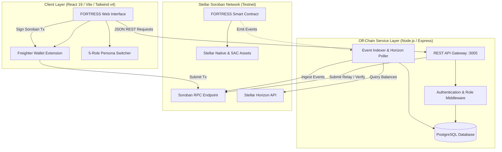
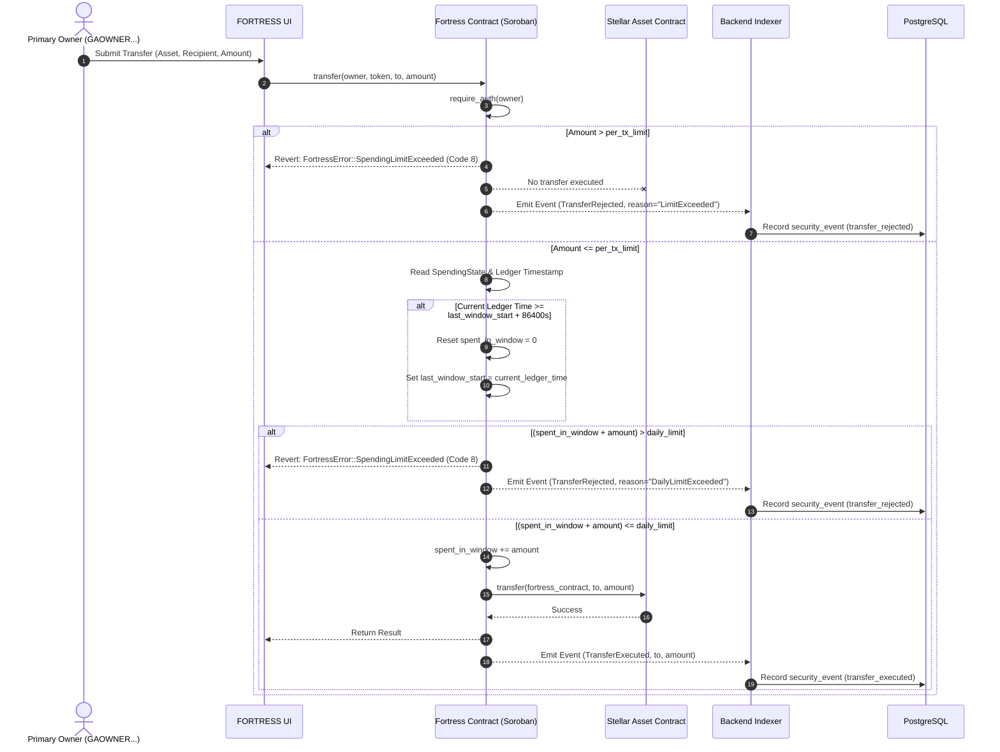
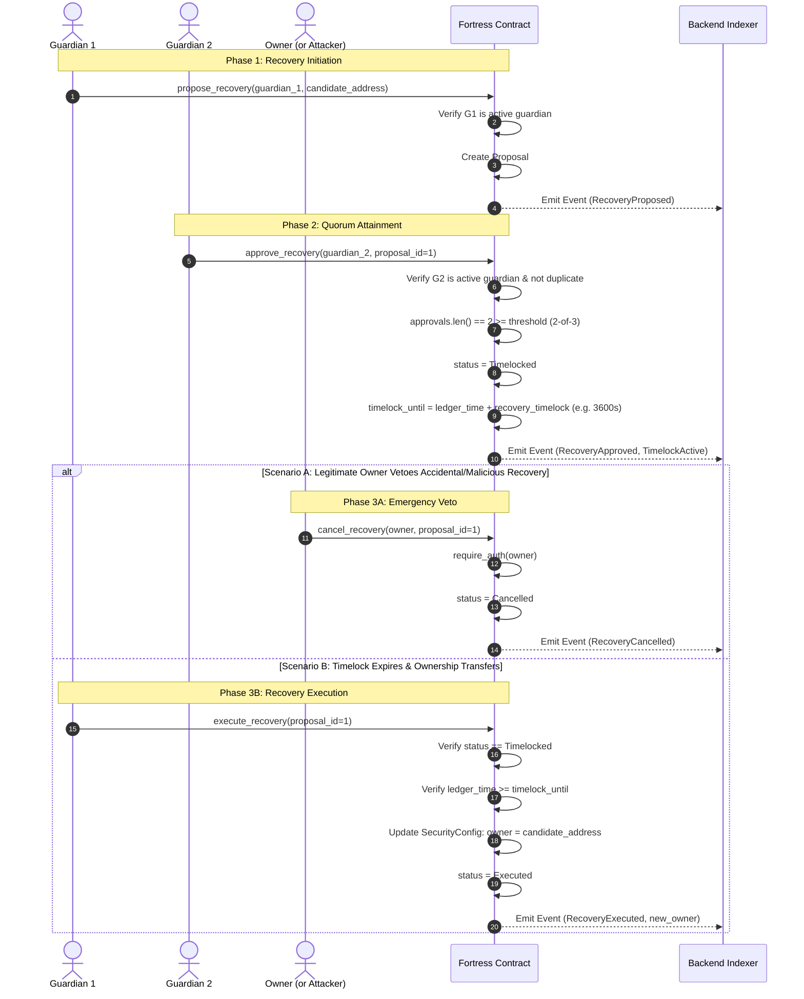

# FORTRESS — Architecture Specification

This document details the architectural design, system boundaries, component interactions, and execution lifecycles of **FORTRESS**, a programmable security smart account wallet on Stellar.

---

## 1. System Overview & Component Topology

FORTRESS follows a decentralized security architecture where the **Soroban smart contract** functions as the root of trust, and the **backend service** acts as a high-performance event indexer and transaction relay.



---

## 2. On-Chain vs. Off-Chain Boundary

| Domain | Component | Responsibility | Failure Impact |
|---|---|---|---|
| **On-Chain** | Soroban Smart Contract | Custody of funds, cryptographic authentication (`require_auth()`), guardian registry, spending limit checks, social recovery state machine, timelock veto enforcement. | Fundamental root of trust. Non-bypassable by any off-chain actor. |
| **On-Chain** | Stellar Asset Contract (SAC) | Token balance tracking (XLM, USDC) and transfer executions (`client.transfer()`). | Governed by Stellar network consensus. |
| **Off-Chain** | Event Indexer | Subscribes to contract events, indexes historical audits, normalizes security logs into relational tables. | Degrades historical audit view in UI; does not compromise wallet funds or authorization. |
| **Off-Chain** | REST API & Database | Caches active proposals, guardian metadata (nicknames/labels), and provides fast querying for web clients. | Clients can fall back to direct Soroban RPC queries if API is offline. |
| **Client** | React UI + Freighter | Key management, user transaction construction, multi-persona simulation, and interactive visualization. | Purely client-side representation. |

---

## 3. Core Sequence Flows

### 3.1 Spending Execution & Limit Enforcement

Any asset transfer initiated from the FORTRESS smart account must satisfy both the **per-transaction limit** and the **24-hour rolling daily limit**.



---

### 3.2 Social Recovery Lifecycle & Owner Veto

The social recovery protocol enables guardians to restore access if the owner loses their key, while providing absolute veto authority to the active owner during the timelock window.



---

## 4. State Storage Layout (Soroban Instance Storage)

The smart contract uses Soroban's native `Env::storage().instance()` persistent storage model. Keys are strictly typed via the `DataKey` enum:

```rust
pub enum DataKey {
    Config,                    // Stores SecurityConfig (owner, threshold, limits, timelock)
    Guardians,                 // Stores Vec<Address> of active guardian addresses
    ProposalCounter,           // Stores u64 autoincrementing recovery ID
    Proposal(u64),             // Stores RecoveryProposal keyed by proposal ID
    Spending(Address),         // Stores SpendingState keyed by asset Address (or Contract ID)
}
```

### Storage Persistence Guarantees
- **Instance Lifetime**: Storage entries are bound to the contract instance lifetime and extended on every state update using `env.storage().instance().extend_ttl(100_000, 200_000)`.
- **Atomic State Transitions**: All updates to proposals and spending counters occur inside atomic contract invocations. If any invariant fails (e.g. invalid threshold, expired proposal), the entire invocation reverts with zero side-effects.

---

## 5. Security Indexer Pipeline

The backend indexer continuously reconciles PostgreSQL with the Soroban RPC ledger:
1. **Ledger Ingestion**: Polls `getEvents` for topic prefix `FORTRESS`.
2. **Event Parsing**: Decodes Soroban SCVal types into structured JSON payloads (`transfer`, `recovery_proposed`, `recovery_approved`, `recovery_cancelled`, `recovery_executed`).
3. **Database Normalization**:
   - Updates `wallets` table with current owner and threshold.
   - Synchronizes `guardians` table active states.
   - Updates `proposals` approval arrays and execution statuses.
   - Appends append-only records to `security_events` with transaction hashes and ledger numbers.

