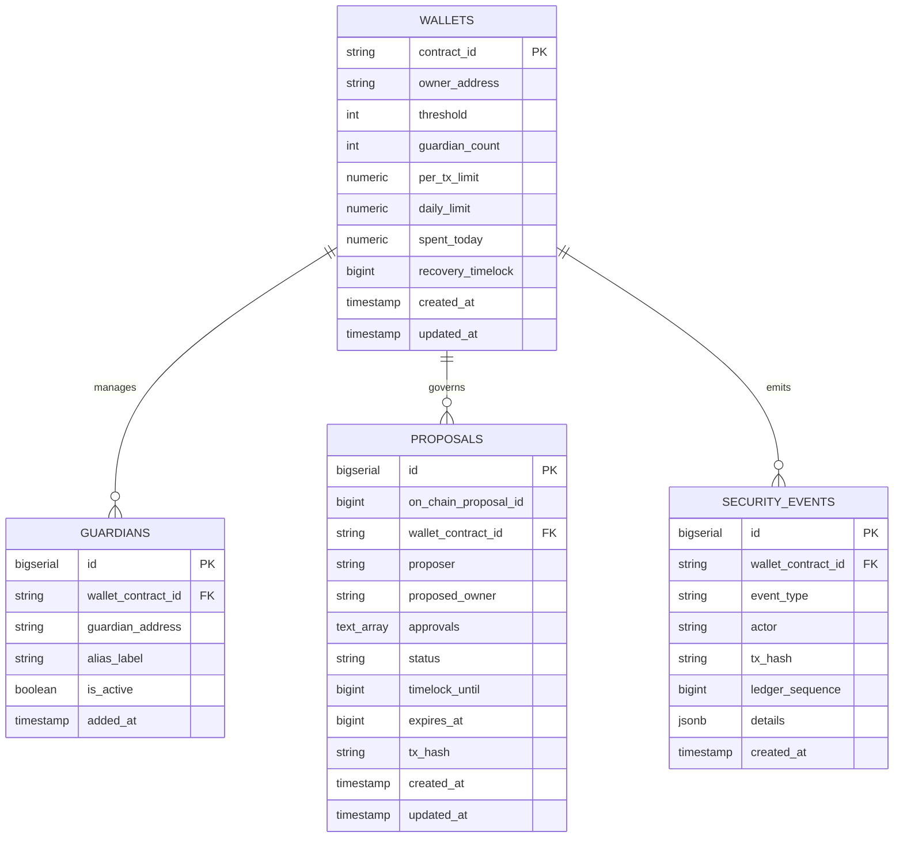

# FORTRESS — Database Schema & Data Dictionary

This document details the relational schema, constraints, indexes, and audit logging invariants of the **FORTRESS** PostgreSQL database (`fortress`).

---

## 1. Entity-Relationship Overview



---

## 2. Table Schemas & Constraints

### 2.1 `wallets`
Stores indexed state of the FORTRESS smart account contract.

```sql
CREATE TABLE wallets (
    contract_id VARCHAR(64) PRIMARY KEY,
    owner_address VARCHAR(56) NOT NULL,
    threshold INTEGER NOT NULL DEFAULT 2 CHECK (threshold >= 1),
    guardian_count INTEGER NOT NULL DEFAULT 0 CHECK (guardian_count >= 0),
    per_tx_limit NUMERIC(20, 7) NOT NULL DEFAULT 500.0,
    daily_limit NUMERIC(20, 7) NOT NULL DEFAULT 1500.0,
    spent_today NUMERIC(20, 7) NOT NULL DEFAULT 0.0,
    recovery_timelock BIGINT NOT NULL DEFAULT 3600 CHECK (recovery_timelock >= 60),
    created_at TIMESTAMPTZ NOT NULL DEFAULT NOW(),
    updated_at TIMESTAMPTZ NOT NULL DEFAULT NOW()
);
```

---

### 2.2 `guardians`
Maintains the list of active guardians registered by the smart account owner.

```sql
CREATE TABLE guardians (
    id BIGSERIAL PRIMARY KEY,
    wallet_contract_id VARCHAR(64) NOT NULL REFERENCES wallets(contract_id) ON DELETE CASCADE,
    guardian_address VARCHAR(56) NOT NULL,
    alias_label VARCHAR(100),
    is_active BOOLEAN NOT NULL DEFAULT true,
    added_at TIMESTAMPTZ NOT NULL DEFAULT NOW(),
    CONSTRAINT uq_wallet_guardian UNIQUE (wallet_contract_id, guardian_address)
);
```

---

### 2.3 `proposals`
Tracks the lifecycle of social recovery proposals across `Pending`, `Timelocked`, `Executed`, `Cancelled`, and `Expired` states.

```sql
CREATE TABLE proposals (
    id BIGSERIAL PRIMARY KEY,
    on_chain_proposal_id BIGINT NOT NULL,
    wallet_contract_id VARCHAR(64) NOT NULL REFERENCES wallets(contract_id) ON DELETE CASCADE,
    proposer VARCHAR(56) NOT NULL,
    proposed_owner VARCHAR(56) NOT NULL,
    approvals TEXT[] NOT NULL DEFAULT '{}',
    status VARCHAR(20) NOT NULL CHECK (status IN ('Pending', 'Timelocked', 'Executed', 'Cancelled', 'Expired')),
    timelock_until BIGINT NOT NULL DEFAULT 0,
    expires_at BIGINT NOT NULL,
    tx_hash VARCHAR(66),
    created_at TIMESTAMPTZ NOT NULL DEFAULT NOW(),
    updated_at TIMESTAMPTZ NOT NULL DEFAULT NOW()
);
```

---

### 2.4 `security_events`
An append-only security audit log indexing all state-altering on-chain events and policy rejections.

```sql
CREATE TABLE security_events (
    id BIGSERIAL PRIMARY KEY,
    wallet_contract_id VARCHAR(64) NOT NULL REFERENCES wallets(contract_id) ON DELETE CASCADE,
    event_type VARCHAR(50) NOT NULL,
    actor VARCHAR(56) NOT NULL,
    tx_hash VARCHAR(66),
    ledger_sequence BIGINT,
    details JSONB NOT NULL DEFAULT '{}',
    created_at TIMESTAMPTZ NOT NULL DEFAULT NOW()
);
```

---

## 3. Database Indexes

High-performance B-tree and GIN indexes ensure rapid querying during real-time event ingestion:

```sql
CREATE INDEX idx_guardians_wallet ON guardians(wallet_contract_id, is_active);
CREATE INDEX idx_proposals_wallet_status ON proposals(wallet_contract_id, status);
CREATE INDEX idx_proposals_on_chain_id ON proposals(wallet_contract_id, on_chain_proposal_id);
CREATE INDEX idx_security_events_wallet_time ON security_events(wallet_contract_id, created_at DESC);
CREATE INDEX idx_security_events_type ON security_events(event_type);
```

---

## 4. Migrations & Seed Scripts

- **Migration**: `database/migrations/001_initial_schema.sql` (Creates tables, foreign keys, and indexes).
- **Seed Data**: `database/seeds/001_seed_dev.sql` (Provides preconfigured smart account, 3 guardians, pending recovery proposal, and sample audit trail events).

